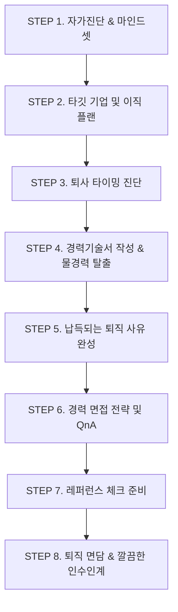

# 🚀 Job Search & Career Transition System (이직 바이블 기반)

> **도서 기반**: 《이직 바이블》 (면접왕이형 / 이준희 지음)  
> **시스템 목적**: 본 프로젝트는 맥의 밀리의 서재 앱에서 추출한 《이직 바이블》의 모든 핵심 원리와 프레임워크를 바탕으로, 성공적인 이직과 취업을 실질적으로 완수할 수 있도록 설계된 **실전 커리어 지식 베이스 및 툴킷**입니다.

---

## 🗺️ 이직 프로세스 로드맵 & 가이드

각 단계별 상세 가이드(`docs/`)와 실전 템플릿(`templates/`)을 순서대로 활용하여 이직 준비를 완성하세요.

---

## 📂 프로젝트 구조 및 핵심 문서

### 1. 지식 베이스 (`docs/`)
- [00. 이직의 본질과 커리어 마인드셋](docs/00_intro_career_mindset.md) - 도피성 이직 vs 목적형 이직, 인사권자의 관점
- [01. 이직 준비 수준 진단 체크리스트](docs/01_self_diagnostic_checklist.md) - 자가진단표와 현재 수준별 실행 권고사항
- [02. 성공적인 이직 플랜과 타깃 기업 선정 기준](docs/02_career_plan_and_targets.md) - 3가지 이직 유형, 기업 4대 선정 기준, 기업 형태별 분석
- [03. 후회 없는 퇴사 타이밍 진단 가이드](docs/03_resignation_timing_diagnosis.md) - 퇴사 신호등(적신호/황신호/청신호), 연차별(1~10년 차) 이직 전략
- [04. 면접관이 뽑고 싶은 경력기술서 작성법](docs/04_career_description_mastery.md) - 물경력 탈출 리프레이밍, 30초 3단 구조, STAR-L 수치화 공식
- [05. 면접관이 의심하지 않는 퇴직 사유 공식](docs/05_resignation_reason_framework.md) - 퇴직 사유 4대 실수, 매슬로우 욕구 단계, 3단계 공식
- [06. 경력직 면접의 특징과 합격 전략](docs/06_experienced_interview_strategy.md) - '신입 같은 경력자'가 되는 법, 4대 빈출 질문 대응법
- [07. 레퍼런스 체크(평판조회) 준비 노하우](docs/07_reference_check_guide.md) - 레퍼리 섭외 및 사전 브리핑 4단계 프로세스
- [08. 완벽하게 마무리하는 퇴사 및 인수인계 가이드](docs/08_resignation_handover_guide.md) - 상사 1:1 보고 순서, 카운터 오퍼 거절 원칙, 인수인계서 작성법
- [09. 커리어 위기 상황별 실전 처방전 (QnA)](docs/09_case_qa_troubleshooting.md) - 안정적인 회사 이직 고민, 상사 가스라이팅, 공백기 극복 등

### 2. 실전 템플릿 (`templates/`)
- [01. 실전 경력기술서 작성 템플릿](templates/01_career_description_template.md) - 기간, 성과, 역할(전략), 기술의 4대 가이드가 반영된 표준 템플릿
- [02. 퇴직 사유 작성 스크립트 빌더](templates/02_resignation_reason_script.md) - 3단계 빈칸 채우기 공식 및 직무별(개발/마케팅) 실전 예시
- [03. 경력직 면접 핵심 QnA 프레임워크](templates/03_interview_qa_framework.md) - 1분 자기소개, 최고 성공 프로젝트, 실패 극복, 갈등 해결, 추천 역질문 3선
- [04. 이직 타깃 기업 분석 및 평가 매트릭스](templates/04_company_evaluation_matrix.md) - 5대 평가 축(25점 만점) 채점표 및 최종 계약 체크리스트

### 3. 추출 원문 및 스크립트 (`data/`, `scripts/`)
- `data/raw/`: 밀리의 서재 로컬 리더에서 실시간 추출한 도서의 48개 원문 챕터 마크다운
- `data/book_toc.json`: 책의 목차 및 스파인 메타데이터 구조화 JSON
- `scripts/extract_book.py`: 밀리의 서재 로컬 포트 통신 및 EPUB 마크다운 자동 추출 스크립트

---

## 💡 AI와 함께하는 구직 활동 활용법

이 리포지토리가 구성되었으므로, 다음과 같이 바로 AI 어시스턴트에게 실무 작업을 요청할 수 있습니다:

1. **경력기술서 첨삭**:
   > *"내 현재 업무 메모를 줄 테니, `templates/01_career_description_template.md`의 성과 수치화 및 역할/전략 공식에 맞춰 다듬어줘."*
2. **맞춤형 퇴직 사유 작성**:
   > *"내 이전 직장 상황과 지원할 회사를 알려줄 테니, `templates/02_resignation_reason_script.md` 공식으로 면접관이 의심하지 않는 스크립트를 짜줘."*
3. **모의 면접(Mock Interview)**:
   > *"`docs/06_experienced_interview_strategy.md`의 경력 면접관 페르소나로 나에게 꼬리 질문을 던지며 모의 면접을 진행해줘."*
4. **타깃 기업 분석**:
   > *"관심 있는 회사 3곳의 채용 공고와 뉴스를 줄 테니, `templates/04_company_evaluation_matrix.md` 기준으로 장단점과 위험 요소를 평가해줘."*

---

## 👤 윤찬민 님 맞춤형 실전 지원 패키지 (`resume/`)

- [01. 윤찬민 마스터 경력기술서 (국문)](resume/01_chanmin_yoon_career_description.md) - 글로벌 테크 PM 포지셔닝 및 4대 가이드(기간·성과·전략·기술) 완벽 적용
- [02. 실전 면접 스크립트 & 스토리라인](resume/02_chanmin_yoon_interview_narrative.md) - 국/영문 1분 자기소개, 3단계 퇴직사유, STAR-L 핵심 질문 대응
- [03. 타깃 기업군 및 포지셔닝 추천 전략](resume/03_chanmin_yoon_target_companies_recommendation.md) - 글로벌 B2B SaaS, 프롭테크/모빌리티, 에듀테크 등 최적 매칭 분석
- [04. 윤찬민 PM 실무 케이스 스터디 포트폴리오](resume/04_chanmin_yoon_pm_portfolio.md) - 3대 대표 프로젝트(어학교육 전수 검증, AI 에이전트 언러닝, 대형빌딩 라이브 무장애 운영) 및 Claude Academy 공식 인증 상세 쇼케이스
