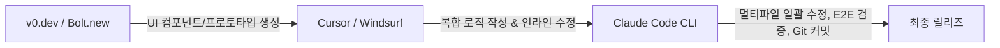

> [!NOTE] 핵심 결론
> 하나의 "만능 도구"는 존재하지 않습니다. **UI 시각화(v0) → 통합 IDE 코딩(Cursor) → 대규모 리팩토링 및 CLI 자동화(Claude Code)**의 파이프라인으로 역할을 분리할 때 개발 및 기획 생산성이 극대화됩니다.

---

## 1. 3대 도구 포지셔닝 비교



| 비교 항목 | Claude Code | Cursor | v0.dev / Bolt.new |
| :--- | :--- | :--- | :--- |
| **인터페이스** | 터미널 CLI (Agentic Terminal) | 데스크톱 IDE (VS Code 기반) | 웹 브라우저 (Live Preview) |
| **주요 역할** | 전체 리포지토리 리팩토링, 디버깅, 스크립트 실행 | 파일별 코드 작성, 인라인 자동완성, 코드베이스 Q&A | 프론트엔드 UI/UX 신속 프로토타이핑 |
| **모델 지원** | Claude 3.7 Sonnet (Thinking 지원) | Claude, GPT-4o, o3-mini 등 선택 가능 | Claude, GPT-4o |
| **MCP 연동** | **기본 내장 (완벽 지원)** | 제한적 지원 | 미지원 |
| **자율성 수준** | 높음 (명령어 실행, 빌드 검증, 에러 자가 치유) | 중간 (인간 주도 인터랙션) | 단일 화면/컴포넌트 중심 |

---

## 2. 실무 워크플로우 베스트 프랙티스

### Step 1: UI 프로토타이핑 (v0.dev)
* 기획 단계에서 PRD나 화면설계서를 작성할 때, 텍스트 프롬프트로 Tailwind CSS + shadcn/ui 기반 인터랙티브 UI 컴포넌트를 즉시 뽑아냄.
* 디자이너/개발자와 논의할 수 있는 실동작 인터페이스를 5분 내 준비.

### Step 2: 아키텍처 구현 (Cursor)
* `.cursorrules` 파일을 프로젝트 루트에 배치하여 프로젝트 컨벤션, 기술 스택, 금지 패턴을 시스템 레벨에서 주입.
* `@Codebase` 또는 `@Web` 심볼을 활용해 전체 코드의 맥락을 참조하며 신규 기능 구현.

### Step 3: 일괄 리팩토링 및 품질 게이트 (Claude Code)
* 복수 파일에 걸친 API 마이그레이션, 테스트 코드 작성, 정적 분석 린트 에러 일괄 수정을 터미널에서 에이전트에게 위임.
* MCP 서버(Git, Docker, Postgres)를 통해 터미널 환경에서 직접 DB 스키마 검증과 단위 테스트를 실행하게 함.

---

## 3. 추천 설정 템플릿

### Cursor `.cursorrules` 권장 구조
```markdown
# Role & Context
You are a senior full-stack engineer and product manager.
The project uses Next.js 15 (App Router), TypeScript, Tailwind CSS, and Supabase.

# Code Style Guidelines
- Use TypeScript strict mode without any 'any'.
- Use functional components with explicit props interfaces.
- Prefer server components unless client interactivity (hooks, state) is strictly required.
- Maintain comprehensive JSDoc comments for complex business logic.
```

---

## 🔗 관련 문서
* [[ai/agent-pipeline-and-cost-optimization|AI 에이전트 파이프라인 설계 및 '언러닝' 비용 최적화]]
* [[ai-tools/index|실무 AI Tools 큐레이션 & 워크플로우 맵]]
* [[cheatsheets/docker-mcp-cheatsheet|Docker & MCP 서버 실무 운영 치트시트]]
