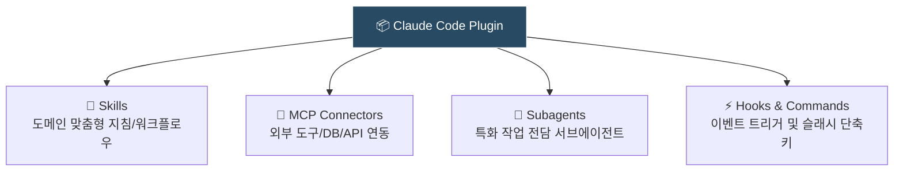

> [!NOTE] 핵심 요약
> **Claude Code**는 터미널에서 코드베이스를 직접 탐색하고 자율 실행하는 에이전틱 코딩 CLI입니다. **Plugin(플러그인)**은 이러한 Claude Code에 맞춤형 **스킬(Skills), 외부 연동 도구(MCP), 전문 서브에이전트(Subagents), 자동화 훅(Hooks)**을 단 한 번의 설치로 묶어서 확장하는 통합 배포 패키지입니다.

---

## 1. Claude Code란?

기존의 AI 코딩 도구(예: GitHub Copilot, 일반 챗봇)는 주로 **채팅창에서 코드를 제안**하거나 **에디터 인라인 자동완성**에 머물렀습니다. 

반면 **Claude Code**는 Anthropic이 개발한 **터미널(CLI) 기반의 에이전틱 코딩 도구(Agentic Coding Tool)**로, 다음과 같은 자율 워크플로우를 가집니다:

1. **코드베이스 전역 탐색**: 수백 개의 파일 중 수정이 필요한 모듈과 함수를 직접 검색하고 파악합니다.
2. **자율 도구 실행**: 파일 편집뿐만 아니라 `git`, `npm test`, 빌드 커맨드 등을 터미널에서 스스로 실행합니다.
3. **피드백 루프**: 테스트나 린트가 실패하면 에러 출력을 분석하여 코드를 다시 수정하고 통과할 때까지 반복합니다.

---

## 2. Claude Code Plugin이란?

Claude Code가 뛰어난 역량을 갖고 있더라도, 프로젝트마다 사용하는 기술 스택(React, Django, Go 등), 사내 인프라, DB, API는 제각각 다릅니다.

**Plugin(플러그인)**은 Claude Code에게 특정 프로젝트나 업무 환경에 필요한 **도구, 지식, 자동화 규칙을 한 번에 주입하는 확장 패키지**입니다.



스마트폰에 앱(App)을 설치하면 카메라 권한, 푸시 알림, 배경 작업이 함께 활성화되는 것처럼, 플러그인을 설치하면 Claude Code에 아래 4가지 핵심 요소가 번들링되어 즉시 제공됩니다.

---

## 3. 플러그인의 4대 구성 요소

### 1) 스킬 (Skills)
- 특정 기술, 프레임워크, 사내 컨벤션에 맞춘 **전문적인 프롬프트 및 절차적 지침**입니다.
- 네임스페이스(`/<plugin-name>:<skill-name>`)를 통해 필요할 때 호출할 수 있습니다.
- 예: React 19 마이그레이션 가이드, 사내 API 작성 표준 등.

### 2) MCP 서버 커넥터 (Model Context Protocol)
- Claude Code가 외부 시스템과 안전하게 통신할 수 있는 인터페이스입니다.
- 데이터베이스 조회(PostgreSQL), 브라우저 제어(Playwright), 이슈 트래커(GitHub/Jira)와 직접 통신합니다.

### 3) 서브에이전트 (Subagents)
- 메인 대화 세션의 컨텍스트를 어지럽히지 않고, **특정 고난도 작업을 격리된 환경에서 수행하는 특화 하위 에이전트**입니다.
- 예: 보안 취약점 전담 분석기, 테스트 실패 원인 전담 디버거.

### 4) 훅 (Hooks) & 슬래시 커맨드
- 세션 수명 주기(Session Lifecycle)나 특정 이벤트에 자동으로 동작하는 트리거입니다.
- 예: `git commit` 직전에 비밀번호/API 키 노출을 막는 사전 검증 훅, `/pr-review` 단축 명령어.

---

## 4. 왜 개별 설정 대신 플러그인을 쓸까?

| 구분 | 플러그인 미사용 (수동 구성) | 플러그인 사용 (Plugin Ecosystem) |
| :--- | :--- | :--- |
| **설치 & 관리** | MCP config JSON 편집, 프롬프트 파일 복사, 훅 스크립트 수동 배치 | `/plugin install <name>` 한 줄로 올인원 설정 |
| **이름 충돌** | 여러 도구가 동일한 명령어/함수 이름을 쓰면 충돌 발생 | 네임스페이싱(`/<plugin-name>:...`)으로 완벽 격리 |
| **팀/조직 공유** | 개인 환경마다 설정 누락, 버전 불일치 발생 | `marketplace.json`과 Git 레포로 전사 표준화 배포 가능 |

---

## 5. 대표적인 플러그인 생태계 예시

- **`typescript-lsp`**:
  Claude에게 실제 TypeScript Language Server를 붙여, 단순 텍스트 예측이 아닌 정밀한 타입 체크, 컴파일 에러 진단, '정의로 이동(Go-to-definition)'을 가능하게 합니다.
- **`playwright`**:
  헤드리스 브라우저를 띄워 E2E 테스트를 구동하고 화면 스크린샷을 찍어 시각적인 회귀 버그를 잡아냅니다.
- **`pr-review-toolkit`**:
  Pull Request 생성 전 코드 스타일 점수화, 변경점 요약, 보안 취약점 사전 감사를 자동화합니다.

---

## 6. 기본 명령어 & 사용법

터미널이나 Claude Code 세션 안에서 플러그인을 검색하고 손쉽게 설치할 수 있습니다:

```bash
# 마켓플레이스 등록
claude plugin marketplace add <owner/repository>

# 플러그인 검색 및 설치
claude plugin install <plugin-name>

# 현재 활성화된 플러그인 목록 확인
claude plugin list
```

---

## 7. 다음 단계
- [ ] 내 개발 프로젝트에 맞는 필수 플러그인(`typescript-lsp`, `playwright` 등) 설치해보기
- [ ] 반복되는 사내 개발 가이드를 직접 커스텀 플러그인으로 패키징해보기
