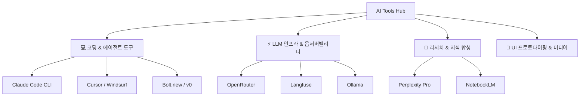

> [!NOTE] 큐레이션 원칙
> 단순한 유행성 AI 서비스 모음이 아닌, **실제 프로덕트 기획, 엔지니어링, 시스템 자동화, 데이터 분석에 유의미한 생산성 향상을 검증한 도구**들만 엄선하여 기록합니다.

---

## 🗺️ AI Tools 생태계 한눈에 보기

---

## 📌 카테고리별 핵심 아티클

| 영역 | 문서명 | 다루는 주요 도구 |
| :--- | :--- | :--- |
| **코딩 & 에이전트** | [[ai-tools/agentic-coding-tools\|에이전틱 코딩 도구 실무 비교 (Claude Code vs Cursor)]] | `Claude Code`, `Cursor`, `Windsurf`, `v0`, `Bolt.new` |
| **인프라 & 평가** | [[ai-tools/llm-infra-and-eval\|LLM 서빙 라우터 & 옵저버빌리티 도구 스택]] | `OpenRouter`, `Langfuse`, `Ollama`, `LiteLLM` |

---

## ⚡ 빠른 도구별 치트 매트릭스

| 도구명 | 주 사용 목적 | 핵심 강점 | 추천 활용 시점 |
| :--- | :--- | :--- | :--- |
| **[Claude Code](https://claude.ai/code)** | 터미널 기반 자동 코딩 에이전트 | MCP 완벽 연동, 멀티 파일 일괄 수정, 깊은 추론 | 리팩토링, 자동화 스크립트 작성, 테스트 완결 |
| **[Cursor](https://cursor.com/)** | AI-First IDE (VS Code 기반) | 코드베이스 전체 인덱싱, 빠른 인라인 자동완성 | 일상적인 프로덕트 개발, 프론트/백엔드 코딩 |
| **[v0.dev](https://v0.dev/)** | 프론트엔드 UI 생성기 (shadcn/ui) | 프롬프트 기반 깔끔한 React 컴포넌트 코드 출력 | 화면설계서 초안, 디자인 시스템 PoC 제작 |
| **[OpenRouter](https://openrouter.ai/)** | 통합 LLM API 게이트웨이 | 단일 키로 모든 모델 접근, 자동 폴백, 실시간 단가 비교 | 멀티 모델 실험, API 비용 최적화 |
| **[Langfuse](https://langfuse.com/)** | 오픈소스 LLM 옵저버빌리티 | 프롬프트 버전 관리, 토큰/비용 추적, 트레이스 분석 | 에이전트 품질 관리, 프로덕션 로깅 |
| **[Perplexity](https://perplexity.ai/)** | 실시간 웹 리서치 엔진 | 논문/기사 실시간 출처 표기, 도메인 필터 검색 | 벤치마킹, 기술 트렌드 조사, 경쟁사 분석 |
| **[NotebookLM](https://notebooklm.google.com/)** | 소스 기반 지식 합성 | 제공 문서 기반 무(無)환각 Q&A, 팟캐스트 요약 | 방대한 기획서/사양서 분석, 도서 챕터 요약 |

---

## 🔗 관련 문서
* [[ai/agent-pipeline-and-cost-optimization|AI 에이전트 파이프라인 설계 및 '언러닝' 비용 최적화]]
* [[ai/mcp-server-protocol|Model Context Protocol (MCP) 규격 및 실무 연동 구조]]
* [[references/curated-tech-bookmarks|실무 생산성 & 개발 도구 큐레이션]]
