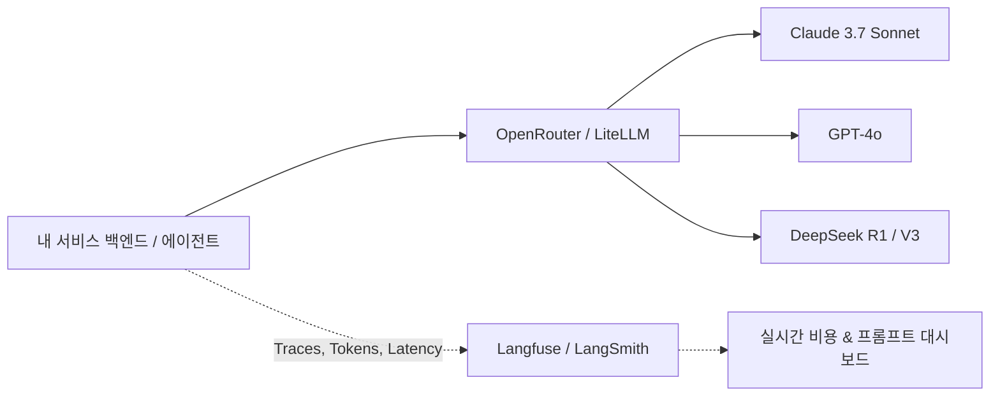

> [!NOTE] 핵심
> AI 기능을 상용 프로덕트에 배포할 때 가장 중요한 것은 **1) 비용/지연 시간 통제(Routing & Fallback)**와 **2) 프롬프트 버전 관리 및 사용자 피드백 추적(Observability)**입니다.

---

## 1. LLM 운영 스택 구성도



---

## 2. 도구별 핵심 기능 및 사용 이유

### ① OpenRouter (API 게이트웨이 & 라우팅)
* **단일 인터페이스**: OpenAI 호환 SDK 포맷 그대로 엔드포인트 URL(`https://openrouter.ai/api/v1`)만 변경하면 200개 이상의 모델 호출 가능.
* **폴백(Fallback) 라우팅**: 메인 모델(예: Claude Sonnet) 장애 발생 시 자동으로 보조 모델(GPT-4o)로 우회하도록 설정.
* **실시간 가격 투명성**: 토큰당 단가 실시간 확인 및 크레딧 한도 제한(Limit)으로 급작스러운 요금 폭탄 방지.

### ② Langfuse (오픈소스 LLM 옵저버빌리티)
* **트레이스(Trace) 시각화**: 에이전트가 툴 콜링을 하고 사용자 입력을 처리하는 전 과정을 단계별 트리 형태로 분석.
* **비용 & 레이턴시 프로파일링**: 어떤 프롬프트나 함수 호출이 비용/시간을 가장 많이 잡아먹는지 정량적으로 파악.
* **데이터셋 및 회귀 평가**: 프롬프트 수정 전/후의 성능을 동일 테스트셋으로 자동 채점(LLM-as-a-judge).

### ③ Ollama (로컬 오픈소스 LLM 구동)
* **네트워크 없는 로컬 추론**: Llama 3.3, Qwen 2.5, DeepSeek R1-Distill 등 최신 오픈 웨이트 모델을 M1/M2/M3 Mac에서 로컬 API로 서빙.
* **민감 데이터 보호**: 외부 유출이 불가능한 사내 내부 문서나 개인 메모 임베딩/요약에 최적.

---

## 3. 실무 예시: OpenRouter + Langfuse 연동 코드 (TypeScript)

```typescript
import OpenAI from "openai";
import { observeOpenAI } from "langfuse";

// Langfuse로 OpenAI SDK 자동 래핑 (모든 호출이 트레이스로 기록됨)
const client = observeOpenAI(
  new OpenAI({
    baseURL: "https://openrouter.ai/api/v1",
    apiKey: process.env.OPENROUTER_API_KEY,
    defaultHeaders: {
      "HTTP-Referer": "https://l-yoon.github.io/notes",
      "X-Title": "Chanmin Tech Notes",
    },
  })
);

async function analyzeProductSpec(specText: string) {
  const response = await client.chat.completions.create({
    model: "anthropic/claude-3.7-sonnet",
    messages: [
      { role: "system", content: "You are a tech PM. Identify edge-case risks." },
      { role: "user", content: specText },
    ],
  });

  return response.choices[0].message.content;
}
```

---

## 🔗 관련 문서
* [[ai-tools/index|실무 AI Tools 큐레이션 & 워크플로우 맵]]
* [[ai/agent-pipeline-and-cost-optimization|AI 에이전트 파이프라인 설계 및 '언러닝' 비용 최적화]]
* [[ai/prompt-engineering-patterns|엔지니어링 관점의 프롬프트 패턴 & Structured Outputs]]
