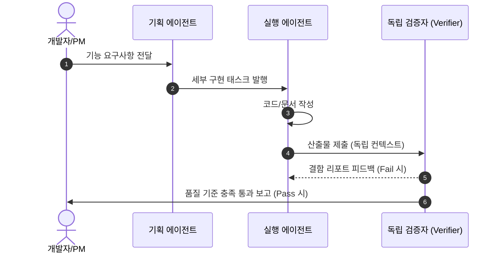

> [!NOTE] 핵심 원칙
> **"조용한 것은 싸다는 증거가 아니다."**  
> 대기 상태(Idle)의 에이전트가 호출 없이 기상(Wakeup)하고 상태를 확인하는 것만으로도 토큰과 인프라 비용이 누수된다. 즉각 반응형 상시 대기보다 **호출 시 기동(On-Demand Event-Driven)** 아키텍처가 실질 비용 효율을 90% 이상 개선한다.

---

## 1. 문제 정의 및 초기 가설

### 초기 가설
* 복수 프로젝트의 요구사항 분석, 코드 리뷰, QA 검증 작업을 12개 전문 에이전트 레인으로 분할.
* 일감이 들어왔을 때 즉시 반응하도록 7개 핵심 레인을 백그라운드 상시 대기(Polling) 구조로 편성.

### 실측 데이터 및 장애 요인

* **측정 결과**: 하루 약 670회 에이전트가 상태를 확인했으나 실제 유효 일감은 2건에 불과.
* **비용 원인**: Context Window가 큰 모델(Claude 3.5 Sonnet / Opus 등)의 시스템 프롬프트가 매 폴링 주기마다 재주입되어 유휴 비용 폭증.

---

## 2. 해결 아키텍처: On-Demand & 품질 게이트 수립

### ① On-Demand 이벤트 기반 기동
* 상시 루프를 완전히 폐기하고, GitHub Webhook 또는 Slack 트리거 시에만 컨테이너 기동.
* 에이전트 간 상태 공유는 파일시스템 대신 경량 Redis/DB 상태 머신 활용.

### ② 독립 검증자(Quality Gate) 패턴
* 작성자 에이전트가 생성한 산출물을 동일한 프롬프트/컨텍스트로 재평가하면 **확증 편향(Confirmation Bias)** 발생.
* **해결책**: 산출물마다 독립된 검증자(Verifier) 에이전트를 별도 기동하며, 작성자가 거치지 않은 테스트 경로와 다른 시스템 프롬프트로 역검증 수행.

---

## 3. 실무 교훈 (PM & 엔지니어링 관점)

1. **에이전트 수명주기 격리**: 단일 거대 에이전트보다 역할이 좁고 확실한 단기 수명(Ephemeral) 에이전트가 디버깅하기 훨씬 용이함.
2. **언러닝(Unlearning)의 가치**: 직접 공들여 구축한 상시 대기 구조라도, 데이터가 비효율을 증명할 때는 즉시 설계를 폐기하고 재설계하는 결단력이 시스템 완성도를 결정함.
3. **관련 문서**:
   * [[ai/mcp-server-protocol|Model Context Protocol (MCP) 규격 및 실무 연동 구조]]
   * [[cheatsheets/docker-mcp-cheatsheet|Docker & MCP 서버 실무 운영 치트시트]]
