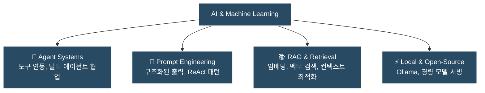

> [!NOTE] 섹션 개요
> 대규모 언어 모델(LLM), 에이전트 시스템, 프롬프트 엔지니어링, RAG 등 **실무와 연구를 통해 직접 검증한 핵심 AI 기술 지식과 구현 패턴**을 다룹니다.

---

## 🔬 핵심 연구 및 학습 영역

---

## 📑 주요 탐구 주제

1. **에이전트 아키텍처 (Agent Architectures)**:
   - Tool Calling, MCP(Model Context Protocol) 규격 및 런타임 제어
   - ReAct(Reasoning + Acting) 루프와 자율적 에러 복구
2. **프롬프트 엔지니어링 & 제어 (Prompt Engineering)**:
   - Few-shot 설계, JSON Schema 기반 Structured Outputs
   - 복합 시스템 프롬프트(System Prompt) 설계 패턴
3. **검색 증강 생성 (RAG) & 메모리**:
   - 하이브리드 검색(키워드 + 시맨틱 벡터), 문서 청킹 전략
   - 에이전트 세션 간 영속 메모리(Persistent Memory) 관리
