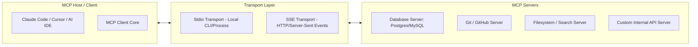

> [!NOTE] 요약
> Anthropic이 공개한 **MCP(Model Context Protocol)**는 LLM 애플리케이션(클라이언트)이 로컬/원격 도구 및 데이터 소스(서버)와 표준화된 JSON-RPC 2.0 프로토콜로 소통할 수 있도록 지원하는 개방형 표준입니다.

---

## 1. 아키텍처 개요

MCP는 웹 개발의 **USB-C 포트**와 같은 역할을 수행합니다. 모델마다 별도의 툴 콜링 커넥터를 작성할 필요 없이 단일 프로토콜로 연동합니다.



---

## 2. 3대 핵심 Primitives (기본 요소)

| 요소 | 방향 | 설명 | 대표 활용 예시 |
| :--- | :--- | :--- | :--- |
| **Resources** | 서버 → 클라이언트 | 모델이 읽을 수 있는 정적/동적 데이터 (파일 내용, DB 스키마 등) | `file:///project/src/main.ts`, `db://schema` |
| **Tools** | 모델 → 서버 실행 | 모델이 인자를 넘겨 실행할 수 있는 함수 (Side-effect 허용) | `execute_sql`, `run_command`, `git_commit` |
| **Prompts** | 서버 → 사용자/모델 | 미리 정의된 대화 템플릿과 워크플로우 가이드 | `analyze-performance`, `generate-testcases` |

---

## 3. 실무 서버 작성 예시 (TypeScript Stdio)

```typescript
import { Server } from "@modelcontextprotocol/sdk/server/index.js";
import { StdioServerTransport } from "@modelcontextprotocol/sdk/server/stdio.js";
import {
  CallToolRequestSchema,
  ListToolsRequestSchema,
} from "@modelcontextprotocol/sdk/types.js";

const server = new Server(
  { name: "custom-metrics-server", version: "1.0.0" },
  { capabilities: { tools: {} } }
);

// 1. 도구 목록 제공
server.setRequestHandler(ListToolsRequestSchema, async () => {
  return {
    tools: [
      {
        name: "get_service_health",
        description: "Returns current health metrics of target microservice",
        inputSchema: {
          type: "object",
          properties: {
            serviceName: { type: "string" },
          },
          required: ["serviceName"],
        },
      },
    ],
  };
});

// 2. 도구 호출 핸들링
server.setRequestHandler(CallToolRequestSchema, async (request) => {
  if (request.params.name === "get_service_health") {
    const service = request.params.arguments?.serviceName;
    return {
      content: [
        {
          type: "text",
          text: JSON.stringify({ service, status: "UP", p99_latency_ms: 42 }),
        },
      ],
    };
  }
  throw new Error("Tool not found");
});

const transport = new StdioServerTransport();
await server.connect(transport);
```

---

## 4. 운영 시 주의사항 (Security & Isolation)

* **최소 권한 원칙**: 파일시스템 MCP 서버 설정 시 전체 루트 디렉토리(`~/`) 대신 타깃 프로젝트 경로만 화이트리스트로 제한.
* **Timeout & Fallback**: 원격 SSE Transport 사용 시 네트워크 지연이 LLM 인퍼런스 전체를 블로킹하지 않도록 5~10초 타임아웃 강제.
* **관련 문서**:
  * [[ai/agent-pipeline-and-cost-optimization|AI 에이전트 파이프라인 설계 및 '언러닝' 비용 최적화]]
  * [[cheatsheets/docker-mcp-cheatsheet|Docker & MCP 서버 실무 운영 치트시트]]
