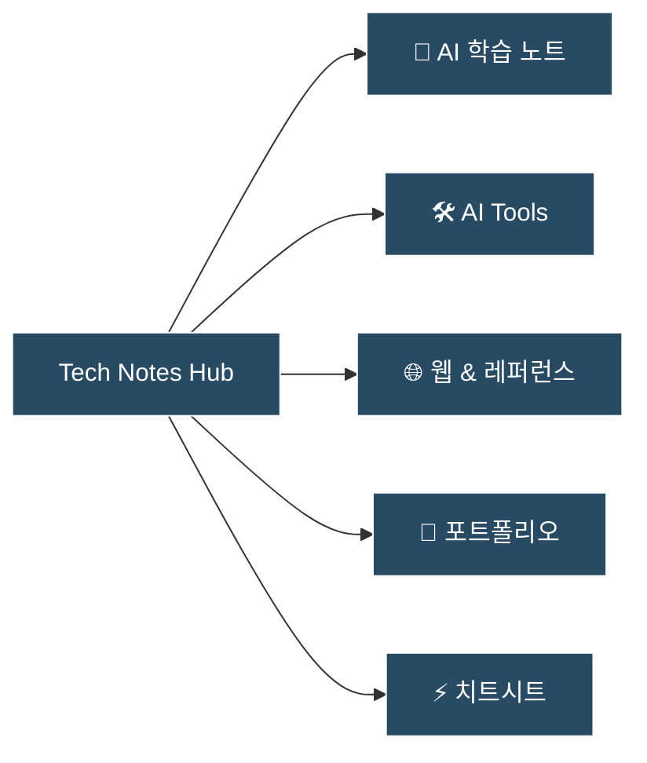

> [!NOTE] About This Knowledge Base
> 실무와 개인 연구를 통해 검증된 **AI 학습 노트, AI 도구 큐레이션, 웹/SaaS 레퍼런스, 기술 포트폴리오**를 기록하는 개인 기술 아카이브입니다. 불필요한 미사여구 없이 직접 검증하고 유용한 정보만을 차곡차곡 축적합니다.

---

## ⚡ 카테고리 바로가기 (Core Sections)

* **🤖 [[ai/index|AI & Machine Learning]]**: AI 이론, LLM 파이프라인, 프롬프트 엔지니어링, 에이전트 실험 등 직접 공부한 기술 노트
* **🛠️ [[ai-tools/index|AI Tools & Ecosystem]]**: 실무에서 검증한 유용한 AI 툴(Claude Code, Cursor 등) 사용기 및 큐레이션
* **🌐 [[references/index|Web & SaaS References]]**: 웹사이트 디자인, SaaS UI/UX 패턴, 아키텍처 벤치마킹 자료
* **💼 [[portfolio/index|Portfolio & Projects]]**: 직접 만든 프로젝트, 쇼케이스 및 기술 프로필
* **⚡ [[cheatsheets/index|Dev Cheatsheets]]**: Docker, Git, CLI 등 자주 쓰는 명령어와 트러블슈팅 가이드

---

## ✍️ 새 글 작성 시작하기
- 글 작성 표준 서식: [[template|새 글 작성 템플릿]]
- `content/` 폴더 내 원하는 카테고리에 마크다운(`.md`) 파일을 생성하면 사이트와 검색창에 자동으로 반영됩니다.

---

## 🏷️ 태그 기반 탐색
상단 검색(`Ctrl/Cmd + K`)과 태그를 통해 전체 지식을 빠르게 검색할 수 있습니다.
* `#ai` `#llm` `#agents`
* `#ai-tools` `#productivity`
* `#references` `#web` `#ui-ux`
* `#portfolio` `#cheatsheet`
