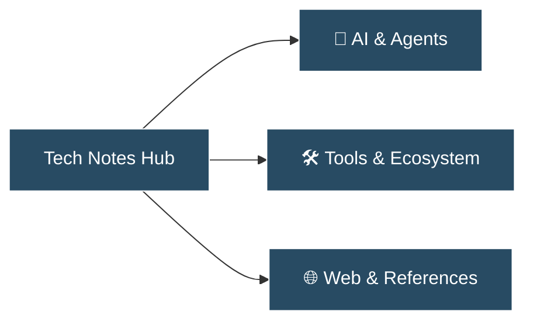

> [!NOTE] About This Knowledge Base
> 실무와 개인 연구를 통해 검증된 **AI 학습 노트, 실무 개발/AI 도구 큐레이션, 웹/SaaS 레퍼런스**를 기록하는 개인 기술 아카이브입니다. 불필요한 미사여구 없이 직접 검증하고 유용한 정보만을 차곡차곡 축적합니다.

---

## ⚡ 3대 핵심 카테고리 (Core Pillars)

* **🤖 [[ai/index|AI & Machine Learning]]**: AI 이론, LLM 파이프라인, 프롬프트 엔지니어링, 에이전트 실험 등 직접 공부한 기술 노트
* **🛠️ [[tools/index|Tools & Ecosystem]]**: Claude Code, Cursor, MCP, 오픈소스 도구 등 실무에서 검증한 도구 사용기 및 비교
* **🌐 [[references/index|Web & Product References]]**: 웹사이트 디자인, SaaS UI/UX 패턴, 서비스 아키텍처 벤치마킹 자료

---

## 📌 주요 아티클 (Featured Notes)
* 🛠️ **[[tools/claude-code-and-plugins|Claude Code와 Plugin 생태계 완벽 가이드]]**: 에이전틱 코딩 CLI의 원리와 Skills, MCP, Subagents, Hooks를 묶는 플러그인 아키텍처

---

## ✍️ 새 글 작성 시작하기
- 글 작성 표준 서식: [[template|새 글 작성 템플릿]]
- `content/ai/`, `content/tools/`, `content/references/` 중 원하는 폴더에 마크다운(`.md`) 파일을 생성하면 사이트와 검색창에 자동으로 반영됩니다.

---

## 🏷️ 태그 기반 탐색
상단 검색(`Ctrl/Cmd + K`)과 태그를 통해 전체 지식을 빠르게 검색할 수 있습니다.
* `#ai` `#llm` `#agents`
* `#tools` `#productivity` `#claude-code`
* `#references` `#web` `#ui-ux`
