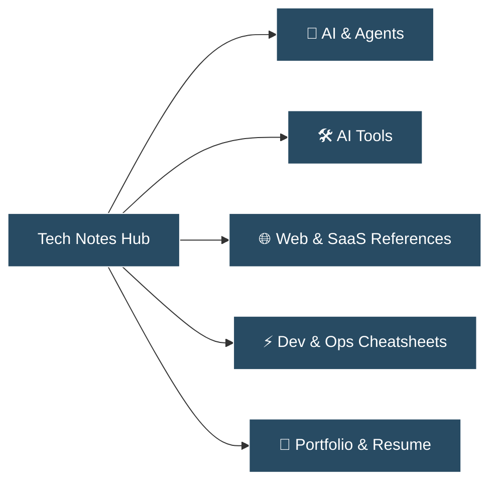

> [!NOTE] About This Knowledge Base
> 실무와 개인 연구를 통해 검증된 **기술 아키텍처, AI 에이전트 시스템, 웹/SaaS 레퍼런스, 엔지니어링 치트시트**를 집약한 개인 기술 아카이브입니다. 불필요한 미사여구 없이 직접 검증하고 재참조 가치가 높은 고밀도 기술 정보만을 기록합니다.

---

## ⚡ 빠른 바로가기 (Core Sections)

* **🤖 [[ai/agent-pipeline-and-cost-optimization|AI & Agent Engineering]]**: AI 에이전트 파이프라인, MCP(Model Context Protocol), 프롬프트 아키텍처 및 비용 최적화
* **🛠️ [[ai-tools/index|AI Tools & Ecosystem]]**: 실무 에이전틱 코딩(Claude Code, Cursor), LLM 서빙/옵저버빌리티(OpenRouter, Langfuse) 워크플로우
* **🌐 [[references/b2b-saas-ux-architecture|Web & SaaS References]]**: 글로벌 SaaS UI/UX 패턴, 정보 구조 설계, 프론트엔드/백엔드 아키텍처 벤치마킹
* **⚡ [[cheatsheets/docker-mcp-cheatsheet|Dev & Ops Cheatsheets]]**: Docker, Git, CLI 도구 및 개발 환경 트러블슈팅
* **💼 [[portfolio/resume|Portfolio & Profile]]**: 글로벌 테크 PM 마스터 이력서 및 프로덕트 완결 쇼케이스

---

## 📌 주요 기술 아티클 (Featured Notes)

| 분류 | 문서명 | 핵심 기술 스택 / 키워드 |
| :--- | :--- | :--- |
| **AI Tools** | [[ai-tools/index\|실무 AI Tools 큐레이션 & 워크플로우 맵]] | `Claude Code`, `Cursor`, `OpenRouter`, `Langfuse` |
| **AI Tools** | [[ai-tools/agentic-coding-tools\|에이전틱 코딩 도구 실무 비교 (Claude Code vs Cursor)]] | `Coding Agents`, `CLI`, `Rules`, `v0`, `Prototyping` |
| **AI System** | [[ai/agent-pipeline-and-cost-optimization\|AI 에이전트 파이프라인 설계 및 '언러닝' 비용 최적화]] | `Docker`, `MCP`, `Claude Code`, `On-Demand Scheduling` |
| **Protocol** | [[ai/mcp-server-protocol\|Model Context Protocol (MCP) 규격 및 실무 연동 구조]] | `MCP`, `LLM Tool Calling`, `JSON-RPC` |
| **Engineering** | [[ai/prompt-engineering-patterns\|엔지니어링 관점의 프롬프트 패턴 & Structured Outputs]] | `Structured Outputs`, `Few-shot`, `ReAct`, `JSON Schema` |
| **Reference** | [[references/b2b-saas-ux-architecture\|B2B SaaS 온보딩 및 복합 데이터 대시보드 패턴]] | `B2B SaaS`, `Dashboard UX`, `Information Architecture` |
| **Reference** | [[references/curated-tech-bookmarks\|실무 생산성 & 개발 도구 큐레이션]] | `Developer Tools`, `Benchmarking`, `API Tools` |
| **Cheatsheet** | [[cheatsheets/docker-mcp-cheatsheet\|Docker & MCP 서버 실무 운영 치트시트]] | `Docker CLI`, `Compose`, `Container Isolation` |
| **Cheatsheet** | [[cheatsheets/git-cli-cheatsheet\|실무 Git 고급 명령어 & 브랜치 복구]] | `Git Rebase`, `Reflog`, `Cherry-pick`, `Submodules` |
| **Portfolio** | [[portfolio/resume\|윤찬민 테크 PM 마스터 경력기술서]] | `Tech PM`, `AI B2B`, `System Maintenance`, `Global` |

---

## 🏷️ 태그 기반 탐색
우측 그래프 뷰(Graph View)와 상단 검색(`Ctrl/Cmd + K`)을 통해 문서 간 상호 연결 구조를 확인할 수 있습니다.
* `#ai` `#agents` `#mcp` `#ai-tools`
* `#web-architecture` `#saas` `#ux`
* `#cheatsheet` `#docker` `#git`
* `#portfolio`
