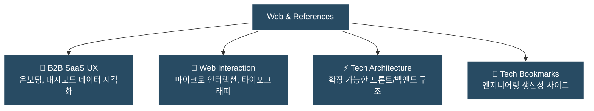

> [!NOTE] 섹션 개요
> 웹사이트 디자인, 글로벌 SaaS UI/UX 패턴, 프론트엔드/백엔드 아키텍처 등 **완결성 높은 프로덕트 개발과 기술 연구를 위한 벤치마킹 아카이브**입니다.

---

## 📌 주요 아카이브 영역

---

## 🎯 벤치마킹 및 분석 기준
- **정보 구조(IA)의 명확성**: 복잡한 비즈니스 로직과 데이터가 사용자에게 직관적으로 전달되는가
- **모던 웹 표준 & 접근성**: Core Web Vitals, 시맨틱 마크업, 키보드 내비게이션 지원
- **인터랙션 피드백**: 사용자 입력에 대한 즉각적이고 매끄러운 상태 전환
- **아키텍처 확장성**: 트래픽 증가와 기능 확장에 유연하게 대처할 수 있는 구조인가
