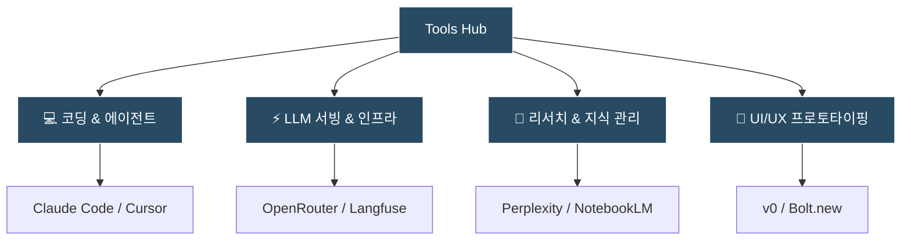

> [!NOTE] 큐레이션 원칙
> 단순한 유행성 서비스 나열이 아닌, **실제 업무와 개발에 유의미한 생산성 향상을 검증한 AI 도구 및 개발 도구**들을 선별하여 기록하고 비교 분석하는 공간입니다.

---

## 🛠️ 주요 관심 도구 영역

---

## ⚡ 실무 검증 도구 퀵 매트릭스

| 도구명 | 카테고리 | 핵심 강점 | 추천 활용 시점 |
| :--- | :--- | :--- | :--- |
| **Claude Code** | 에이전틱 코딩 CLI | 터미널 기반 자동 코드 탐색 및 대규모 리팩토링 | 로컬 저장소 전체 분석, CLI 기반 빌드/테스트 루프 |
| **Cursor** | IDE 통합 코딩 | 프로젝트 전역 인덱싱 및 멀티 파일 수정 | 코드베이스 탐색, 인라인 자동완성 |
| **OpenRouter** | LLM 라우팅 | 단일 API 키로 수십 개 모델 스위칭 & 폴백 | 모델별 가성비 비교, 다운타임 없는 백업 |
| **Langfuse** | 옵저버빌리티 | LLM 호출 트레이싱, 토큰 비용 및 레이턴시 모니터링 | 프로덕션 API 비용 및 품질 추적 |

---

## 📌 주요 아티클 & 실무 가이드
* 📖 **[[tools/claude-code-and-plugins|Claude Code와 Plugin 생태계 완벽 가이드]]**: 에이전틱 코딩 CLI의 작동 원리와 Skills, MCP, Subagents, Hooks를 하나로 묶는 플러그인 아키텍처 심층 분석
