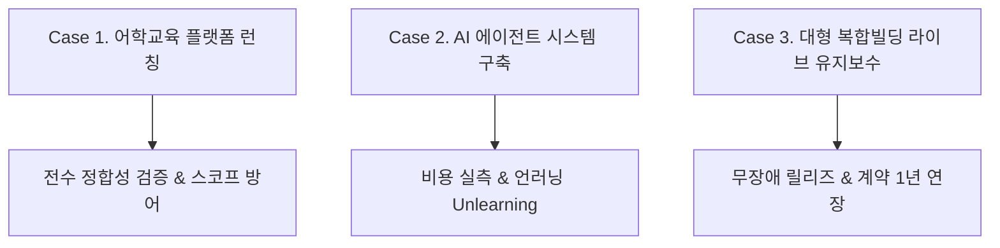
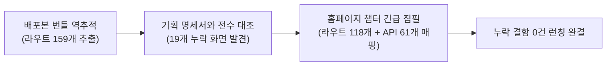
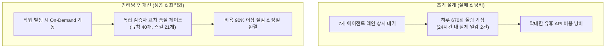

# 💼 Product Manager Portfolio (윤찬민)
### "개발팀의 보고를 검증 없이 넘기지 않는다" — 데이터 정합성과 실측 기반의 글로벌 테크 PM

---

## 👤 Profile & Executive Summary

* **성명**: 윤찬민 (Chanmin Yoon)
* **포지션**: Global Technical Product Manager / Product Owner
* **연락처**: `+82 10-9621-2114` · `chanmin.yoon23@gmail.com`
* **학력**: 광운대학교 미디어커뮤니케이션학부 졸업 (학점 3.78/4.5) · St. Lawrence College (캐나다) 2년 수료
* **어학**: 영어 유창 (Fluent, TOEIC 915점) — 인도 시니어 개발팀 9인과 100% 영문 스크럼 리딩
* **총 경력**: 1년 2개월 (디비컨설팅 매니저 / PM)

```
       [글로벌 오프쇼어 엔지니어링]
       (원어민급 영어, 인도 개발팀 리딩)
                    ∩
       [테크니컬 백엔드 / 코드 검증]
       (소스코드 역추적, API/DB 로그 실측)
                    ∩
       [엔터프라이즈 B2B / 플랫폼 운영]
       (조선호텔, 코람코, 골드앤에스 런칭)
                    ↓
   ★ High-Impact Global Technical PM ★
```

---

## 🎖️ 공인 자격 및 검증된 핵심 역량

| 인증 / 교육 | 발급 기관 | 취득일 | 검증 링크 / 내용 |
| :--- | :--- | :---: | :--- |
| **AI Fluency: Framework and foundations** | **Claude Academy** | **2026.10.01** | [공식 인증서 확인](https://academy.claude.com/verify/c9752163de0adcb5d6a8bfb2eacd5208) |
| **Fundamentals of Agents** | **Hugging Face** | 2025.05 | AI 에이전트 아키텍처 및 툴 연동 프레임워크 이수 |
| **Google Analytics Certification (GAC)** | **Google** | 2025.02 | 웹/앱 퍼널 데이터 분석 및 이벤트 트래킹 |
| **AI 웹 개발 프로젝트 최우수상** | 스파르타코딩클럽 | 2024.10 | LLM 연동 웹 프로덕트 기획 및 개발 1위 |

---

## 📂 Key Case Studies (실무 프로젝트 케이스 스터디)



---

## Case 1. 대형 어학교육 플랫폼 전면 리뉴얼 & 전수 정합성 검증

* **기간**: `2025.08 ~ 현재 (13개월)`
* **고객사**: 국내 대형 어학교육 기업 (코스닥 상장사 계열)
* **팀 규모**: 오프쇼어 엔지니어 9인 + PM 1인 (단독 리드)
* **기술 스택**: NestJS, Next.js, Flutter, ASP.NET(레거시), MSSQL, MySQL, Figma, Jira



### 1. 문제 정의 (Problem)
* **명세서와 실제 코드의 심각한 괴리**: 기존 기획 명세서와 실제 배포본 간의 일치 여부가 검증되지 않은 채 런칭이 임박해 있었음.
* **고객사-개발팀 간 감정적 대립**: 변경 요청이 쏟아지며 고객사는 "요구가 반영되지 않는다", 개발팀은 "요구가 끝도 없이 늘어난다"며 프로젝트 마비 위기 직면.

### 2. 가설 및 해결 프로세스 (Hypothesis & Solution)

#### ① 배포 번들 역추적을 통한 누락 서피스 19개 화면 발견 및 신규 집필
* 개발팀의 구두 보고를 신뢰하는 대신, **프론트엔드 배포 번들에서 라우트 코드를 전수 추출** (관리자 107개, 앱 33개, 홈페이지 19개).
* 명세서와 대조한 결과, 학생·학부모용 홈페이지 19개 화면이 기획서에서 통째로 누락되어 있음을 최초 규명.
* 화면 설계서와 API 61개 매핑 문서를 직접 신규 집필하여 런칭 전 누락 결함 0건을 확정.

#### ② 변경요청 60건 3대 근본원인 전수 분류 매트릭스 (스코프 방어)
* 고객사의 60개 변경 요청을 감정 대신 **3대 근본원인 데이터**로 전수 분류:
  * **원인 A (스펙 오해 / 개발팀 귀책)**: 16건 $\rightarrow$ *우리 쪽 과실을 먼저 데이터로 인정*
  * **원인 B (계약 외 신규 요구 / 고객사 귀책)**: 41건 $\rightarrow$ *계약서 및 초기 WBS 대조를 통해 증명*
  * **원인 C (스펙 모호 / 상호 협의)**: 3건
* **결과**: 전체 변경 요청의 **68.3%(41건)가 계약 범위 밖임을 입증**하여 무상 공수 낭비를 막고, 일정 연장 및 추가 과업 계약의 정당한 근거 확보.

#### ③ 레거시 데이터 45.5만 건 무손실 이관
* 2개 레거시 DB의 데이터 스키마 및 권한을 사전 매핑하여 미이관 자산(이미지 616건, 첨부 457건)을 사전에 가시화.
* **이관 결과**: 총 455,447건 중 454,917건 성공 (**99.88% 무손실 이관 달성**).

### 3. 정량적 성과 (Impact)
* **결함 완결률**: 일일 결함 트래커 운영을 통해 142건 중 101건(71.1%) 조기 종결.
* **권한 무결성**: 64개 화면 × 5개 계정(최고관리자, 지사장, 분원장, 강사, 학부모) 전수 로그인 검증으로 권한 탈취/노출 사고 0건.

> **💡 PM Retrospective**:  
> *"개발팀의 보고를 검증 없이 넘기지 않고 소스코드를 역추적했을 때, 프로젝트의 숨은 뇌관을 사전에 제거할 수 있었습니다. 모호한 요구는 감정이 아닌 데이터로 정의해야 고객과 개발팀 모두를 지킬 수 있습니다."*

---

## Case 2. PM 업무 자동화 AI 에이전트 시스템 구축 & ‘언러닝(Unlearning)’

* **기간**: `2026.07 ~ 현재`
* **프로젝트 성격**: 자체 R&D 과제 (1인 다프로젝트 PM 운영 자동화)
* **기술 스택**: Claude Code, Docker, MCP (Model Context Protocol), Python, Git



### 1. 문제 정의 (Problem)
* 여러 개의 엔터프라이즈 프로젝트를 동시에 총괄하면서, 반복적인 WBS 점검, 산출물 정합성 대조, 결함 분류에 소모되는 리소스가 급증.
* PM 운영 자동화를 위해 Docker 및 MCP 기반으로 7개 에이전트 레인을 구축했으나, **예상치 못한 인프라 비용 누수 발생**.

### 2. 해결 프로세스와 '언러닝(Unlearning)'

#### ① 최초 설계의 맹점 발견 (실측 데이터)
* 일이 들어왔을 때 즉시 반응하도록 7개 에이전트 레인을 상시 대기(Polling)시키는 구조를 구축함.
* 24시간 비용 실측 결과: **에이전트들이 하루 약 670회 기상하는 동안, 실제 처리한 일감은 단 2건**에 불과했음.
* "조용한 상태"를 유지하고 확인하는 데 막대한 토큰과 비용이 소모되고 있었음을 데이터로 확인.

#### ② 자기 설계의 신속한 폐기 및 On-Demand 재구축
* 본인이 직접 공들여 만든 상시 대기 구조의 비효율을 솔직히 인정하고 즉시 폐기(**Unlearning**).
* 작업 이벤트가 트리거될 때만 필요한 도구를 장착해 기동하는 **'호출 시 기동(On-Demand)' 구조로 전면 재설계**.
* 산출물마다 작성자가 쓰지 않은 독립 검증자를 별도 기동하는 교차 검증 게이트(운영 규칙 40개 자산화) 수립.

### 3. 정량적 성과 (Impact)
* **유휴 비용 절감**: 상시 대기 대비 API 비용 **90% 이상 절감**.
* **품질 게이트 자산화**: 40여 개 운영 규칙 및 21개 재사용 스킬 모듈 구축.
* **글로벌 인증 취득**: **Claude Academy "AI Fluency: Framework and foundations"** 공식 배지 취득 (2026.10).

> **💡 PM Retrospective**:  
> *"조용한 것은 싸다는 증거가 아닙니다. 가설이 틀렸음을 데이터로 확인했을 때, 본인의 설계를 고집하지 않고 즉시 폐기하고 피벗하는 유연함이야말로 프로덕트 매니저의 가장 중요한 덕목입니다."*

---

## Case 3. 서울 도심 대형 복합빌딩 라이브 유지보수 & 1년 계약 연장

* **기간**: `2025.07 ~ 현재 (14개월)`
* **대상 사이트**: 센터필드(조선호텔앤리조트), 그랑서울(코람코자산신탁)
* **서피스**: 웹 관리자, 입주사 모바일 앱, DID 키오스크 등 5개 서피스
* **기술 스택**: Vue 3, NestJS, Flutter, GCP, REST API

### 1. 문제 정의 (Problem)
* 이미 매일 수천 명이 출입·예약·주차를 이용 중인 라이브 시스템을 무중단으로 유지보수해야 하는 고난도 미션.
* 계약 만료(2026.06)를 앞두고 고객사의 신뢰를 확보해 유지보수 계약을 연장해야 하는 비즈니스 목표 존재.

### 2. 핵심 실행 내용 (Action)
* **코드 영향도 직접 분석을 통한 D-2 무장애 배포**:
  * 신규 입점사 키오스크 화면 반영 시, DB 스키마 변경 없이 프론트엔드 하드코딩 3개소만 수정하면 됨을 코드로 직접 증명.
  * 개발팀의 불필요한 공수 산정을 방어하고, 오픈 예정일 2일 전 무장애 배포 완료.
* **장기 미해결 주차 연동 오류 종결**:
  * 주차 할인 연동 오류 발생 시, 개발자가 '테스트 주차장 ID'를 참조하고 있던 원인을 규명하자 기존 기획 가설을 신속히 철회하고 모니터링 기준 재수립.

### 3. 정량적 성과 (Impact)
* **비즈니스 성과**: 1년간 단 1건의 치명적 다운타임 없는 안정적 운영으로 **유지보수 계약 1년 연장 갱신(2027.06까지) 성사**.
* **다중 서피스 운영**: 5개 서피스 간 실시간 QR 동기화 및 주차 할인 프로세스 무장애 완결.

---

## Case 4. 대형 통신사 AI B2B 솔루션 (A.dot biz) 3자 협업 브릿지

* **기간**: `2025.12 ~ 2026.04 (4개월 완결)`
* **성격**: 대형 통신사 B2B AI 서비스 3자 협업 Bridge PM

### 핵심 기여 내용
* **원청 대기업 - 당사 컨설팅 - 개발 파트너사** 간의 복합적 이해관계 조율.
* 모호한 비즈니스 요구사항을 개발 가능한 세부 기능 명세(WBS)로 통역·구체화하여 4개월 단기 마일스톤 성공적 완결.

---

## 🛠️ 종합 역량 및 보유 스킬셋

```
┌────────────────────────────────────────────────────────────────────────┐
│ 1. Product Management                                                  │
│   • PRD 집필, WBS 수립, 유저플로우 설계, 화면설계서, 와이어프레임(Figma)│
│   • R&R 정의, 스코프(Scope) 방어, 고객사 변경요청 데이터 분석         │
├────────────────────────────────────────────────────────────────────────┤
│ 2. Technical PM & Quality Assurance                                    │
│   • 코드 역추적(NestJS/Vue 3/Next.js/Flutter), API 명세/DB 로그 실측    │
│   • 권한 매트릭스 전수 검증, 일일 결함 트래커 운영, 마이그레이션 무손실│
├────────────────────────────────────────────────────────────────────────┤
│ 3. Global Offshore Leadership                                          │
│   • 인도 시니어 엔지니어링 팀(최대 9인)과 100% 영문 테크니컬 스크럼   │
│   • 영어 유창(Fluent, TOEIC 915점), 해외 컬리지 수료                   │
├────────────────────────────────────────────────────────────────────────┤
│ 4. Modern AI Tooling & Automation                                      │
│   • Claude Code, Docker, MCP, Playwright, Python 자동화 스크립트       │
│   • Claude Academy AI Fluency 공식 인증 (2026.10)                      │
└────────────────────────────────────────────────────────────────────────┘
```
